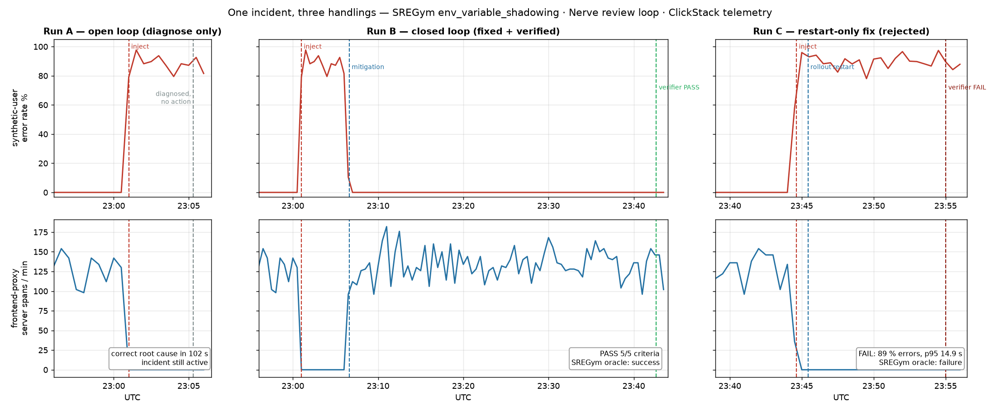
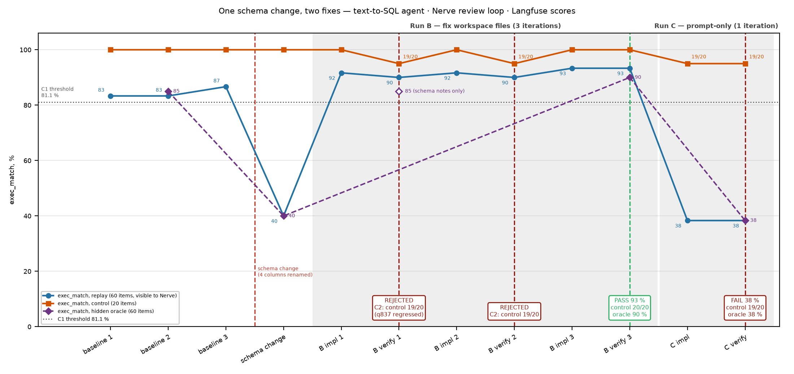
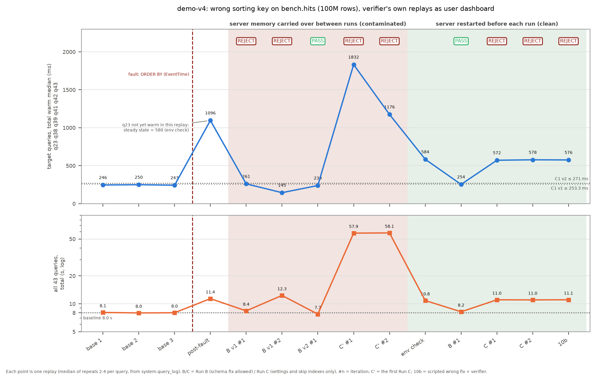

# nerve-experiments

Three experiments that ran the [Nerve](https://github.com/ClickHouse/nerve) review loop (Claude implementer → Codex verifier) over runtime signals stored in ClickHouse-based systems: SRE telemetry in ClickStack, agent-quality scores in Langfuse, and ClickHouse's own `system.query_log` for a database performance fix.
The question was whether Nerve's independent verifier could reliably evaluate fixes using external runtime signals — SRE telemetry, agent-quality scores and database performance — without changes to Nerve core, and what would break in practice.
Answer: it worked with zero core changes. The adaptations were in verifier criteria, MCP integrations (stock `mcp-clickhouse` for SRE and DB performance, a custom six-tool adapter for Langfuse), skills and Codex configuration overrides. Nerve core, including the review loop, remained unchanged. All 6 negative runs of the first two cases were rejected with the verifier's own numbers, and the hidden oracles agreed in 11 of 12 runs. In the third case the clean Run B passed and both negative runs (Run C, scripted wrong fix 10b) were rejected; getting a clean pair took three Run B and two Run C attempts, because the harness first let server memory and earlier runs' notes leak between runs.

**Scope.** What these cases show is runtime verification: inside one review loop, a verifier accepts or rejects a fix using numbers it fetched itself. Verified memory and self-improvement across loops (lessons that are checked before they are reused) were not tested. They are a proposed next step. Nerve memory writes failed with 401 in the SRE and DB cases, and in the DB case the agents' own lesson notes were quarantined between runs so that they could not affect later runs.

## Where to find what

| | SRE / ClickStack | Agent quality / Langfuse | DB performance / `query_log` |
|---|---|---|---|
| Hypothesis and setup | [README](sre-clickstack/README.md), [prompts](sre-clickstack/prompts/) | [README](agent-quality-langfuse/README.md), [prompts](agent-quality-langfuse/prompts/) | [README](clickhouse-perf/README.md), [prompts](clickhouse-perf/prompts/) |
| Results | [FINDINGS](sre-clickstack/FINDINGS.md), [run2](sre-clickstack/evidence/run2/FINDINGS-run2.md), [repeats](sre-clickstack/evidence/repeats/summary.md) | [FINDINGS](agent-quality-langfuse/FINDINGS.md), [scores_table](agent-quality-langfuse/evidence/scores_table.md) | [FINDINGS](clickhouse-perf/FINDINGS.md) (top table, §3 all runs) |
| Negative controls | Run C, C2, 3 repeat C runs ([verdicts](sre-clickstack/evidence/verdicts.md)) | Run C ([verdict](agent-quality-langfuse/evidence/run-c/verdict-iter1.json)) | Run C ([verdict](clickhouse-perf/evidence/run-c/verdict-iter2.json)), 10b ([verdict](clickhouse-perf/evidence/negative-control/verifier/verdict-iter1.json)), B v1 iteration 2 |
| Limitations and deviations | FINDINGS "What this does not show" | FINDINGS "Gaps / caveats" | FINDINGS §7 deviations, §9 limits; C1 changed after Run B v1 (§2) |
| Raw evidence | [`sre-clickstack/evidence/`](sre-clickstack/evidence/) | [`agent-quality-langfuse/evidence/`](agent-quality-langfuse/evidence/) | [`clickhouse-perf/evidence/`](clickhouse-perf/evidence/) |

`evidence/` holds what the runs produced (verdicts, STATE files, transcripts, oracle output). Historical transcripts have been minimally sanitized to remove personal filesystem paths and private host details. Experimental results, criteria and verdicts are unchanged. `prompts/` holds the goals and verifier criteria as the agents received them, earlier criteria versions included. Reproduction instructions are in each case README.

*SRE case: synthetic-user error rate and edge traffic for Run A (open loop), Run B (fix, passed) and Run C (restart-only, rejected). From [sre-clickstack/FINDINGS.md](sre-clickstack/FINDINGS.md).*

*Agent-quality case: exec_match on the visible replay set, the 20-item control subset and the hidden oracle set across baseline, schema change, Run B (fix accepted on iteration 3 after the control gate rejected two over-tuned prompts) and Run C (prompt-only, rejected). Every verifier point is the verifier's own replay. Run ids are in [scores_table.md](agent-quality-langfuse/evidence/scores_table.md).*

*Database performance case: target-query total and whole-workload total for every verifier replay of ClickBench `hits` with a wrong sorting key. Red band: attempts in which server memory carried over between runs; green band: server restarted before each run. From [clickhouse-perf/FINDINGS.md](clickhouse-perf/FINDINGS.md).*

## Results

| Case | Signal | Fix attempted | Verifier | Hidden oracle (DB: control set) |
|---|---|---|---|---|
| SRE, fault 1 (env shadowing) | ClickStack SLIs | config fix (Run B) | pass | success |
| SRE, fault 1 | ClickStack SLIs | restarts only (Run C) | fail | false |
| SRE, fault 2 (traffic policy) | ClickStack SLIs | config fix (B2) | pass | success |
| SRE, fault 2 | ClickStack SLIs | restarts only (C2) | fail | failure |
| SRE, fault 1, repeats ×3 each | ClickStack SLIs | config fix / restarts only | B: 2 pass, 1 false rejection (cluster noise); C: 3 fail | B: 3 success; C: 3 failure |
| Agent quality | Langfuse exec_match | schema notes + 3 prompt rules (Run B) | pass | 90 % |
| Agent quality | Langfuse exec_match | prompt-only append (Run C) | fail | 38 % |
| DB performance | `system.query_log` replay | rebuild with the original sorting key (Run B) | pass | control set: hashes equal, no regression |
| DB performance | `system.query_log` replay | settings and skip indexes only (Run C) | fail | — (C1 572 ms vs 271) |
| DB performance | `system.query_log` replay | scripted wrong fix: bloom_filter + `max_threads` (10b) | fail | — (C1 576 ms vs 271) |

SRE values: [sre-clickstack/FINDINGS.md](sre-clickstack/FINDINGS.md), [run2/FINDINGS-run2.md](sre-clickstack/evidence/run2/FINDINGS-run2.md), [repeats/summary.md](sre-clickstack/evidence/repeats/summary.md). Across the 10 SRE runs, verdict and oracle agreed in 9. Agent-quality values: [agent-quality-langfuse/FINDINGS.md](agent-quality-langfuse/FINDINGS.md). Baseline was 83–87 % and post-fault 40 %. DB performance values are clean runs under criteria v2 (C1 threshold changed by the operator after Run B v1; both result sets are in [clickhouse-perf/FINDINGS.md](clickhouse-perf/FINDINGS.md)). That case has no independent oracle: its check is a hidden control set of 10 queries plus result hashes.

Timings and cost per run are in the case FINDINGS.

## What did not change

- **Nerve core** was used as-is, pinned at `4173725dc2723ee9e3b41c05522f695ba72e6b1d` ([PINS.md](PINS.md)). No case changed `nerve/` or `sregym/`.
- **SRE case** changed verifier criteria text (C1–C5 as explicit SLIs and windows), the stock `mcp-clickhouse` server, two skills (`clickstack-schema`, `incident-triage`) and two Codex `extra_config` overrides (sandbox network, explicit approval of the local MCP server).
- **Agent-quality case** changed verifier criteria text (C1–C5 over Langfuse scores), a 6-tool MCP adapter over the Langfuse experiments API ([`langfuse-tools/`](agent-quality-langfuse/langfuse-tools/langfuse_tools.py)), two skills (`langfuse-schema`, `agent-tuning-playbook`) and the same explicit MCP approval override plus a tool timeout.
- **DB performance case** changed verifier criteria text (C1–C7 over the verifier's own `query_log` replay), two instances of the stock `mcp-clickhouse` server with different ClickHouse users, one tool-level skill (`clickhouse-diagnostics`) and the same Codex overrides. Isolation came from ClickHouse grants and row policies, not from Nerve.

## What had to live outside the core

Nerve core ran unchanged. Everything below was done in workspace config, criteria text and skills; a product built on the loop would want it in the core.

For a product version:
- **Criteria as SLO queries with a noise tolerance.** Criteria are prose. There are no pinned SLO queries or first-class verification windows (start event, minimum duration, baseline offset), so every leg re-derives them.
- **A verification window with a validity check** (baseline, minimum duration, the system actually served traffic). There is no validity or noise guard on a verification window: host sleep, cluster-wide slowdowns and LLM run-to-run spread all reach the verdict unflagged.
- **ClickStack and Langfuse as first-class sources** instead of a separate MCP server per signal: each case needed its own MCP server configuration and a schema skill.
- **A verify-after delay.** There is no verify-after delay. The implementer leg has to `sleep` until telemetry covers the window.

Implementation notes:
- **Local MCP approval is a security boundary.** Nerve auto-approves MCP tools for the Codex verifier only for servers that come through its managed gateway. An MCP server the operator adds locally is not trusted automatically, so under `approval_policy=never` Codex refuses its tools. Unattended verification therefore needs an explicit Codex `extra_config` override per local server: `mcp_servers.<name>.default_tools_approval_mode: approve`. In the SRE case the first verifier leg ran without it and correctly marked C5 unmet, which cost one iteration.
- **The Codex verifier sandbox has no network by default.** Reaching a local kind cluster needed `sandbox_workspace_write.network_access: true`.
- Nerve's own untracked `.nerve-review/` directory shows up in `git status` of the loop repo and tripped a scope criterion (agent-quality C4).

## Limitations

- SRE diagnosis was not blind: the `incident-triage` skill tells the agent to look for duplicated env var names, which is the mechanism of fault 1. The SRE case tests verification of a fix, not root-cause discovery ([SRE FINDINGS](sre-clickstack/FINDINGS.md), "What this does not show").
- SRE: one app (astronomy-shop) and 2 SREGym fault types. Agent quality: one agent, one BIRD database (`superhero`), one fault (4 column renames). DB performance: one table, one fault (sorting key), n = 1 per clean configuration.
- n per configuration: SRE B 5 runs and C 5 runs (4 + 4 on fault 1, 1 + 1 on fault 2); agent-quality B 1 and C 1. The C runs were designed to fail, not sampled.
- The first two cases ran on one 24 GB Mac (kind cluster, Docker Desktop at 16 GB). Host or cluster noise affected 3 runs: Run B (host memory), rep2-B (in-cluster Jaeger), C2 (host asleep). The DB performance case ran its server on a dedicated bench host after the Mac baseline spread was 7.7 s.
- Implementer Claude Opus 5.5, verifier Codex CLI, system under test (agent-quality case) Claude Haiku 5.5. Versions in [PINS.md](PINS.md).

## Reproduce

| Case | Command | Wall-clock |
|---|---|---|
| SRE | `bash sre-clickstack/scripts/up.sh`, then [sre-clickstack/README.md](sre-clickstack/README.md) | ~8 min warm (~20 cold) + 15 min clean baseline + 10–37 min per loop |
| Agent quality | `bash agent-quality-langfuse/up.sh`, then [agent-quality-langfuse/README.md](agent-quality-langfuse/README.md) | ~10 min + 7–21 min per loop |
| DB performance | [clickhouse-perf/README.md](clickhouse-perf/README.md) (server on a dedicated ≥ 16 GB host) | ~30 min build + baseline, 6–85 min per loop |

All cases clone or pull their upstreams at the commits and digests in [PINS.md](PINS.md).

**Reproduction requires macOS.** The setup scripts assume macOS, Homebrew and Docker Desktop: `/opt/homebrew/...` paths, `host.docker.internal`, `caffeinate` in `repeat.sh`, and the macOS Keychain (`security`) for the Claude token. They were not tested on Linux. On Linux the paths and the token step have to be changed by hand. The DB case's server only needs Docker on a host with ≥ 16 GB for the container; its client scripts are Python and bash.

## Links

- Findings: [cross-case](FINDINGS.md) · [SRE](sre-clickstack/FINDINGS.md) · [agent quality](agent-quality-langfuse/FINDINGS.md) · [DB performance](clickhouse-perf/FINDINGS.md)
- SRE verdicts with the SQL and numbers: [sre-clickstack/evidence/verdicts.md](sre-clickstack/evidence/verdicts.md)

## Third-party benchmarks and data

Exact upstream revisions are in [PINS.md](PINS.md). Third-party material redistributed here keeps its own license and is not covered by this repository's Apache 2.0 license.

- **[SREGym](https://github.com/SREGym/SREGym)** (MIT). Fault scenarios and mitigation oracles for the SRE experiment. SREGym's code is not included; it is fetched separately.
- **[ClickBench](https://github.com/ClickHouse/ClickBench)** ([CC BY-NC-SA 4.0](https://creativecommons.org/licenses/by-nc-sa/4.0/)). The original `hits` table DDL and the 43 benchmark queries for the ClickHouse performance experiment. `clickhouse-perf/queries/regression.sql` holds the queries unmodified. `regression_c6.sql` is adapted from them: each `ORDER BY` gets a full tie-breaker. Both are under CC BY-NC-SA 4.0. The `hits` dataset is downloaded separately.
- **[BIRD](https://bird-bench.github.io/)** ([CC BY-SA 4.0](https://creativecommons.org/licenses/by-sa/4.0/); Li et al., "Can LLM Already Serve as A Database Interface? A BIg Bench for Large-Scale Database Grounded Text-to-SQLs", NeurIPS 2023). Dev-set questions, evidence hints and reference SQL from the `superhero` database for the agent-quality experiment. They are in `agent-quality-langfuse/data/replay.jsonl` and in that case's evidence, under CC BY-SA 4.0. The BIRD databases are downloaded separately.
