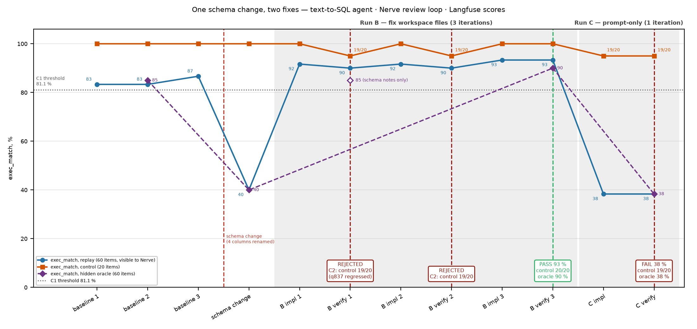

# agent-quality-langfuse: closed loop on agent quality (Langfuse)

This case builds a self-hosted Langfuse and a text-to-SQL agent (Claude Haiku 5.5, BIRD `superhero`) that is
traced and scored in it. It then injects a schema change, after which Nerve's review loop
(Claude implementer → Codex verifier) has to restore the agent's quality. The implementer may edit only the
agent's workspace files. The verifier must replay the dataset itself and read the scores back from Langfuse.

Result: post-fault exec_match 40 %. Run B passed on iteration 3 (verifier's own replay 93 %, hidden oracle 90 %); Run C
(prompt-only) was rejected (38 %, oracle 38 %).



*Agent-quality case: exec_match on the visible replay set, the 20-item control subset and the hidden oracle set across baseline, schema change, Run B (fix accepted on iteration 3 after the control gate rejected two over-tuned prompts) and Run C (prompt-only, rejected). Every verifier point is the verifier's own replay. Run ids are in [scores_table.md](evidence/scores_table.md).*
Intermediate implementer runs (an iteration's earlier replays) are listed in `scores_table.md`; each "B impl N" point is the last one before verifier N.

| Read | What |
|---|---|
| [FINDINGS.md](FINDINGS.md) | results, the control-gate catch, noise-derived C1, C4 wording bug, caveats |
| `evidence/run-b/`, `evidence/run-c/` | per-leg transcripts, `verdict-iter*.json`, STATE.md, `workspace.diff`, workspace git log |
| `evidence/baseline.json`, `post-fault.json`, `scores_table.md`, `oracle-scores.json` | per-run scores (oracle: summaries only) |
| `prompts/` | Run B/C goals, verifier criteria C1–C5: `verifier.md` = the criteria of the recorded runs, `verifier.tmpl.md` = template |
| `agent/` | system under test (fingerprinted; the implementer could not edit it) |
| `workspace/` | baseline workspace the loops started from |
| `langfuse-tools/`, `skills/`, `nerve-config.yaml` | MCP adapter, Nerve skills, Nerve config additions (no secrets) |
| `scripts/`, `up.sh` | Langfuse bring-up, splits, fault injection, verifier fill, plots |

Upstreams are cloned into `vendor/` at the commits in [../PINS.md](../PINS.md). The loops use `sre-clickstack/scripts/nerve_api.py`.

```
 Langfuse (docker, 127.0.0.1:3000) ◄── traces + scores ── agent/run.py (Haiku 5.5, single shot, SQLite)
        ▲  experiments API                                    ▲ reads prompt.md / schema_notes.md / skills/
        │                                                     │
 langfuse-tools/langfuse_tools.py (stdio MCP: list_runs, get_run_scores, get_failed_traces,
        │                      run_experiment, describe_live_db, agent_fingerprint)
        ▼
 Nerve review loop ── implementer edits ~/nerve-v3-loops/<run>/workspace (git) ── verifier replays `replay`
 hidden: ~/nerve-demo-private/v3/oracle.jsonl (60 items, scored locally by agent/run.py oracle)
```

## 0. Prerequisites
- Docker Desktop with about 8 GB memory. Langfuse v4 has 7 containers: web, worker, ai-gateway, postgres,
  clickhouse, redis, minio.
- `uv`, and a Nerve install as in [../sre-clickstack/README.md](../sre-clickstack/README.md) (`vendor/nerve`, gateway on 127.0.0.1:8900).
- BIRD dev 20240627, unpacked so that this path exists:
  `vendor/bird/dev_20240627/dev_databases/superhero/superhero.sqlite`.
- Put `ANTHROPIC_API_KEY=sk-ant-…` in `agent-quality-langfuse/.env` or the repo-root `.env`. Both files are gitignored.

## 1. Bring-up (≈10 min, ~$0.2 of Haiku)
```bash
bash agent-quality-langfuse/up.sh
```
The script does the following, in order:
1. Starts Langfuse (`scripts/langfuse-up.sh`: random secrets, ports on localhost only, headless init of the
   org `nerve-demo` and the project `text2sql`).
2. Builds the venv.
3. Runs `scripts/build_splits.py`:
   - 120 questions: 60 go to the Langfuse dataset `replay`, 20 of which are marked `control`, and 60 go to the
     hidden oracle file;
   - the control questions touch none of the renamed columns in gold SQL, question or evidence;
   - safe to re-run: the split is deterministic (seed 20261110); `data/replay.jsonl` and
     `agent/schema_snapshot.md` are compared with the recorded files, never overwritten; local files and the
     Langfuse dataset are created only if missing (`--check` reports without writing).
4. Runs three identical baselines (`baseline`, `baseline-2`, `baseline-3`) and the oracle baseline.
5. Runs `scripts/fill_verifier.py`, which writes the frozen criteria of this reproduction into `runs/verifier.md`
   (gitignored; `prompts/verifier.md` stays the recorded runs' criteria and is not written). The C1
   threshold is the baseline mean − max(1 pp, the baseline spread).
6. Runs `scripts/inject.py --kind rename`:
   - renames `superhero.full_name`→`civilian_name`, `superhero.height_cm`→`stature_cm`,
     `publisher.publisher_name`→`imprint` and `superpower.power_name`→`ability`;
   - regenerates the gold SQL and checks that it returns the same rows as before.
7. Runs `post-fault` on both splits.
8. Creates the loop repos `~/nerve-v3-loops/run-{b,c}`. They contain only `workspace/`.

## 2. Nerve wiring (once)
- `vendor/nerve/config.yaml` needs:
  - `mcp_servers.langfuse-tools` (stdio: the `agent-quality-langfuse/.venv` python and `langfuse-tools/langfuse_tools.py`);
  - `codex.extra_config` entries `mcp_servers.langfuse-tools.default_tools_approval_mode: approve` and
    `mcp_servers.langfuse-tools.tool_timeout_sec: 1800`.
  A copy is in `nerve-config.yaml`.
- Skills: `cp -R agent-quality-langfuse/skills/* ~/nerve-demo-workspace/skills/`. This installs
  `langfuse-schema` and `agent-tuning-playbook`.
- `vendor/nerve/.venv/bin/nerve start`, then `bash sre-clickstack/scripts/refresh_claude_token.sh`. Refresh right before
  every loop, because Claude Code rotates the token.

## 3. Runs
```bash
# Run B: real fix (budget $8, ≤3 iterations)
python3 sre-clickstack/scripts/nerve_api.py loop --title "v3 Run B" --goal-file agent-quality-langfuse/prompts/run-b-goal.md \
  --verifier-file agent-quality-langfuse/runs/verifier.md --budget 8 --max-iterations 3 \
  --cwd ~/nerve-v3-loops/run-b --out agent-quality-langfuse/runs/run-b --wait --abandon-on-park
# Run C: negative case (may only append general instructions to prompt.md), 1 iteration
python3 sre-clickstack/scripts/nerve_api.py loop --title "v3 Run C" --goal-file agent-quality-langfuse/prompts/run-c-goal.md \
  --verifier-file agent-quality-langfuse/runs/verifier.md --budget 4 --max-iterations 1 \
  --cwd ~/nerve-v3-loops/run-c --out agent-quality-langfuse/runs/run-c --wait --abandon-on-park
# hidden oracle on each final workspace
agent-quality-langfuse/.venv/bin/python agent-quality-langfuse/agent/run.py oracle --label run-b --workspace ~/nerve-v3-loops/run-b/workspace
agent-quality-langfuse/.venv/bin/python agent-quality-langfuse/agent/run.py oracle --label run-c --workspace ~/nerve-v3-loops/run-c/workspace
# new runs land in agent-quality-langfuse/runs/ (gitignored); evidence/ keeps the recorded runs the figures use
# figures + score table
uv run --with matplotlib python agent-quality-langfuse/scripts/plot_v3.py   # reads the recorded evidence/, writes PNGs to runs/ (--out-dir)
```

## 4. Isolation and what it does not cover
- The implementer's cwd is a repo that contains only `workspace/`. The agent code, the frozen schema reference
  and the oracle file sit in other directories.
- They are still readable on disk, because the legs have a shell. So the boundary consists of three things:
  - the instructions;
  - the verifier's C4 (`git diff` limited to `workspace/` plus `agent_fingerprint`);
  - the hidden oracle, which catches overfitting to `replay`.
- The replay dataset exposes expected SQL, as a real Langfuse dataset would. A workspace that memorised it would
  pass C1 and show up on the oracle.

## 5. Teardown
```bash
vendor/nerve/.venv/bin/nerve stop
docker compose -p langfuse -f vendor/langfuse/docker-compose.yml down        # add -v to drop all Langfuse data
agent-quality-langfuse/.venv/bin/python agent-quality-langfuse/scripts/inject.py --kind recover # pristine DB + original gold
```
