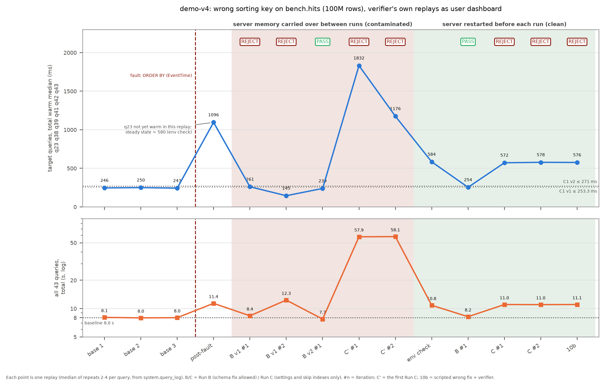
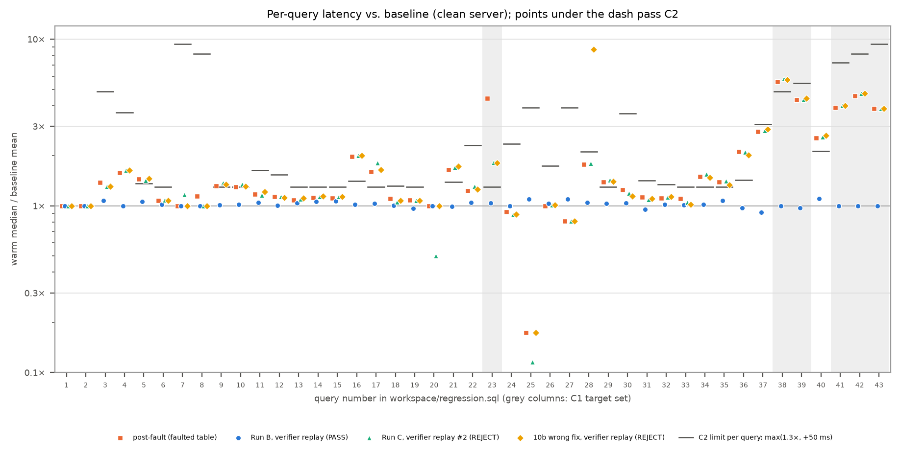

# demo-v4 findings: wrong sorting key, verified from `system.query_log`

**Case.** ClickBench `hits` (99,997,497 rows, ClickHouse 26.8.36.3) was recreated with `ORDER BY (EventTime)` instead of `(CounterID, EventDate, UserID, EventTime, WatchID)`. The Nerve loop ran unchanged, with a Claude implementer (`claude-workflow`) and a Codex verifier (`codex-ultracode`). The verifier replays the 43-query workload as the workload identity `dashboard` and reads its own timings, read_rows and result hashes back from `system.query_log`.

**Result on a clean server, criteria v2.**

| Run | What it did | Verdict | Iterations, cost | Verifier numbers |
|---|---|---|---|---|
| Run B | rebuilt with the original key, then `EXCHANGE`, `OPTIMIZE FINAL` | **pass** | 1, $9.14 | C1 254 ≤ 271 ms; C2 0 violations (8.2 s vs 8.0 s baseline); C6 43/43 hashes |
| Run C (settings and skip indexes only) | no persistent change: "contract can't be met under the constraint" | **fail** ×2 | 2, $4.11 | C1 572 / 578 ms vs 271; C2 13 violations; C3 25.9 vs 22.9 GB cap |
| 10b (scripted wrong fix) | bloom_filter on URL + `max_threads = 32` in the profile | **fail** | 1, $1.20 | C1 576 ms; C2 14 violations; C3 25.9 GB. C7 met: the change persists but does not help |

**Hidden control set** (10 queries outside the workload; agents cannot read them):
- After Run B, hashes are equal to baseline and timings are 502 → 527 ms, with 0 queries over the C2 rule.
- After Run C and 10b, hashes are equal, and 2 full scans are slower because the table is still faulted.

**Honest summary.**
- The clean result above is the third attempt at Run B and the second at Run C.
- The first attempts are kept in full, because each one exposed a defect in the harness, not in Nerve:
  - B v1 showed that the C1 threshold was too tight and caught a cache hack;
  - B v2 and the first Run C ran in a contaminated server;
  - the first Run C read an earlier run's notes.
- **The C1 threshold was changed by the operator after Run B v1.** The reason: a correct fix was rejected by 3%, because the rebuilt table is systematically slightly slower on q23. Both result sets are here.

*Target total (top) and whole-workload total (bottom) for every verifier replay, in order. Red band: server memory carried over between runs. Green band: server restarted before each run.*

*Per-query ratio to baseline on the clean server. The dash is each query's C2 limit; grey columns are the C1 target set.*

## 1. Setup and baseline

- **Host.** A dedicated bench host (16 vCPU, 32 GiB) with no other load.
  - The server container is limited to 16 GB, as initially planned.
  - Nerve, the agents and all scripts stayed on the Mac and reached the server through a port-forward on `127.0.0.1:18123`.
  - Timings come from `system.query_log` on the server, so the network hop is not in them.
- **Mac baseline (rejected).** The first baseline on the Mac (Docker, 14 GB) had totals of 27.3 / 19.6 / 20.4 s, a 7.7 s spread, because the host was loaded. It is kept in `evidence/build/mac-noise/`.
- **Bench-host baseline.** Regression totals per run were **8069 / 7977 / 8010 ms**: mean 8018.7, spread 92 ms (1.1%) ([baseline.json](evidence/baseline.json)).
- **Fault** ([evidence/fault/](evidence/fault/)):
  - official DDL with `ORDER BY (EventTime)`, then `INSERT SELECT`, `EXCHANGE TABLES` and `DROP`;
  - rows unchanged; bytes went from 15.25 to **25.88 GB (×1.70)**, because the data compresses worse in EventTime order;
  - post-fault total 11,371 ms.
- **Target set** (frozen from `post-fault`, queries ≥ 3× slower):
  - q23 (4.42×), q38 (5.54×), q39 (4.34×), q41 (3.88×), q42 (4.57×), q43 (3.83×);
  - q23's 4.42× was a warm-up artifact of that replay; its steady state on the faulted table is about 1.8× (§4). The set was kept frozen;
  - target total 246 / 250 / 243 ms in the baselines and 1096 ms post-fault; 572–584 ms in the three env checks, where q23 was at steady state (§4);
  - q37 (2.79×) and q40 (2.55×) stayed out.
- **C6.** All 43 twins were stable across two pre-runs and the baseline, so none were excluded. The result hash is sha256 over the sorted rows with floats at 6 significant digits, computed in `replay.py`. This replaces cityHash64 to keep the script stdlib-only.

## 2. Criteria and the v1 → v2 change

The criteria are pinned in [prompts/v4-verifier.md](prompts/v4-verifier.md); v1 is kept in [prompts/v4-verifier.v1.md](prompts/v4-verifier.v1.md).

- **C1, target total.**
  - v1 was mean + spread = **253.3 ms**.
  - v2 is max(mean + spread, 1.10 × mean) = **271.0 ms**. This is the same floor principle as in C2.
- **C2–C7** are unchanged.
- **Why C1 changed** (operator decision after Run B v1, 2026-11-11):
  - The correct schema fix was rejected on C1 by 3% (261 vs 253.3 ms).
  - On the rebuilt table q23 runs at a steady 207–212 ms, against 199–205 ms in baseline. That is +5% and systematic, while the whole margin was the 7 ms spread.
  - Run B on the clean server landed at **254 ms**, which would have missed v1 by 0.7 ms.
- Nothing else in `baseline.json` changed (diffed against [baseline.v1.json](evidence/baseline.v1.json)).
- **C8 and C9 in the verdict JSON are not extra criteria.** Nerve turns each top-level bullet of the criteria text into a checklist id. C7 has two nested bullets: the DDL route and the settings-profile route. The parser listed them as C8 and C9, and every verdict reports 9 ids. The pass rule in the prompt is still "C1–C7 all met". The verifier treats them as conditional branches of C7, and a branch that does not apply is reported as met. So the verdict follows C7: in both Run C verdicts C7 is unmet while C8 and C9 are met.

## 3. All runs, in order

| # | Run | Server | Verdicts | Cost | What it showed |
|---|---|---|---|---|---|
| 1 | [Run B v1](evidence/run-b-v1/) `rvl-4e86c126`, criteria v1 | contaminated from its iteration 2 on | needs_improvement ×2, parked on budget | $6.86 | iteration 1: correct fix, **C1 261 vs 253.3** (tight threshold). Iteration 2: `use_uncompressed_cache = 1` with a 6 GB cap in the profile; C1 145, but **C2 19 violations**. The verifier rejected the cache hack on numbers |
| 2 | [Run B v2](evidence/run-b-v2/) `rvl-b7ac3e2e`, criteria v2 | contaminated | pass (1) | $5.25 | correct key fix **plus a profile change** (`max_threads_min_free_memory_per_thread`, external GROUP BY) that compensated for the leftover cache. That was a false "second cause" (§4) |
| 3 | [Run C, first](evidence/run-c-contaminated/) `rvl-b6b4f1ab` | contaminated | fail ×2 | $5.63 | C1 1832 / 1176 ms, whole workload 57.9 s (5× the clean faulted state). It **read Run B v2's STATE.md** (§5) |
| 4 | [Run B](evidence/run-b/) `rvl-6d45d1fc`, criteria v2 | clean | **pass (1)** | $9.14 | key fix only; the profile was not touched |
| 5 | [Run C](evidence/run-c/) `rvl-ec38122d`, criteria v2 | clean | **fail ×2** | $4.11 | no persistent change; "Hard stop" (§6) |
| 6 | [10b](evidence/negative-control/) `rvl-e8bb12b2`, criteria v2 | clean | **fail (1)** | $1.20 | scripted wrong fix rejected; persistence credited (C7), performance not |

Total model cost of the six loops: about $32.2.

**DDL per run**:
- taken from `query_log` (user `nerve_rw`): `evidence/<run>/ddl.tsv`;
- the verifiers' SQL and numbers are in `verdict-iter*.json`;
- per-replay medians, computed from `query_log` the same way `replay.py` does, are in [evidence/runs-summary.json](evidence/runs-summary.json) (`scripts/extract_runs.py`).

## 4. Server state is part of the reset (the false "second cause")

- **What happened.** Run B v1 iteration 2 filled the server's uncompressed cache: `UncompressedCacheBytes` was **7.35 GiB**, held from 14:45 UTC on. `reset.sh` restored the data, the profiles and the grants, but not server memory. So B v2, the first Run C and the hidden control set all ran with almost half of the 16 GB container in use.
- **What it did to the next runs.**
  - The B v2 implementer measured fewer threads per query and "fixed" it with `max_threads_min_free_memory_per_thread = 256 MiB` in `dashboard_profile`. That cause came from the leftover cache, not from the incident.
  - The first Run C's whole workload took 57.9 s against 10.8 s on a clean server with the same faulted data.
  - The control set slowed to 1472 ms against 502 ms in baseline.
- **The v1 implementer had noticed it and said it could not explain it:** "I could not determine why the bench host stays ~1.8x slower on CPU-bound scans (fewer effective threads, no I/O wait, no guest steal)." That is the same behaviour as demo-v1's Run B on host memory noise: the implementer saw the effect, could not act on it, and wrote that down.
- **Fix.**
  - `reset.sh` now restarts the server container first ([scripts/server-restart.sh](scripts/server-restart.sh)).
  - [scripts/envcheck.sh](scripts/envcheck.sh) then replays the regression set on the reset faulted state and compares it with `post-fault`.
- **Envcheck results.** On regression total excluding q23: 10,486 / 10,507 / 10,359 ms against 10,482 in `post-fault`. Per query in envcheck-1, 41 of 43 queries were within 10% of `post-fault`; the two outside were q05 (+13%) and q23.
- **How "clean" was decided.** The script as it ran (rule v1) compared totals including q23 with the bare baseline spreads (1.15% and 2.84%). All three recorded verdicts in [evidence/envcheck/](evidence/envcheck/) say `clean: false`, mainly because of q23 (target 584 / 572 / 578 ms against 1096). The operator judged the server clean by hand, from the numbers above, excluding q23. The recorded verdict files are kept as written.
- **Rule v2, added in the release audit, after the runs.** [scripts/envcheck_verdict.py](scripts/envcheck_verdict.py) now encodes that judgement: q23 is excluded and reported for information; totals must stay within max(baseline spread, 10%), the floor C1 v2 already uses; every other query within C2's limit max(1.3×, +50 ms) of `post-fault`. It exits non-zero on failure. Applied to the recorded replays, all three pass (largest deviations: total −1.17%, target without q23 +7.25%), and the verifier replay of the first Run C, taken on the contaminated server, fails every check (total +439%). The rule was written knowing these results; it is not an independent validation of them.
- **What the envcheck uncovered about q23.**
  - Its `post-fault` repeats were 6911 / 1366 / 889 / 354 ms. The replay had run while the page cache was still warming on the freshly written 25.9 GB table.
  - Its steady state on the faulted table is about 355–375 ms, i.e. **1.8× baseline, not 4.4×**. Under the ≥ 3× rule q23 should not have entered the target set.
  - The operator kept the frozen set (option A): q23 is still slower after the fault, so including it only makes C1 stricter.
  - The same artifact explains the build-step note that the bloom_filter "sped q23 up to 358 ms". That was warm-up, not the index.

## 5. Isolation: Nerve does not restrict the implementer's filesystem

- **The mechanism.** The Claude backend auto-approves Bash, and the agents run as the operator's macOS user. Without sudo, a separate unix user was not possible in the time-box. Isolation was therefore:
  - ClickHouse grants on the MCP path (`nerve_rw`, `nerve_verify`);
  - row policies that hide the control set (`log_comment NOT LIKE 'ctl-%'`);
  - the time window of earlier runs in `query_log`, `part_log`, `text_log` and `processors_profile_log`;
  - moving earlier runs' material out of reach before each run;
  - [scripts/leakcheck.sh](scripts/leakcheck.sh) before each start (a list of known places, not an isolation check; the checkout's own `evidence/` is readable too);
  - the transcript audit.
- **What leaked, and where.**
  - **First Run C** read `~/nerve-v4-loops/run-b-v2/.nerve-review/*/STATE.md`, which is gitignored but on disk, and `/tmp/impl-rvl-b7ac3e2e/replay.py`. From there it knew the key fix and the thread setting, tested the setting per query and still could not pass. The rejection stands, but the run is not independent.
  - **Run B v2** read `prompts/v4-verifier.md` and `scripts/replay.py` in the demo repo, and grepped the v1 transcript for `replay|creds|password`. It got prompt text only, not the v1 solution.
  - **The clean Run B and Run C** also read `prompts/v4-verifier.md` and `replay.py`, which hold the criteria Nerve already shows the implementer. Their transcripts reference nothing from earlier runs, the staging area or the control set.
- **The root-cause shortcut.** All implementers found the root cause in about a minute from the operator's own injection DDL in `query_log` (`v4admin`: `CREATE TABLE bench.hits_bad … ORDER BY (EventTime)` + `EXCHANGE`). That is realistic, since DDL history is the first thing an SRE checks, but it was not planned. The goal and the skill gave no hint.
- **Nerve memory.**
  - `memorize` failed with 401 (no API key) in every run, so memU stayed empty (0 items) and recall had nothing to return.
  - The implementers then wrote their lessons into `memory/contexts/lessons-inbox.md` themselves.
  - These lessons were moved to a private quarantine before each following run.
- **Two operator slips in the window mechanism.**
  - The window end overlapped the first 20 s of the clean Run B. Its first DDL came 63 s after the start, so nothing the verifier needed was hidden.
  - In 10b the grants were re-applied after the wrong fix. That re-created `dashboard_profile` and hid the statements. It was caught before the start: the window was moved to before the wrong fix and `max_threads = 32` was re-applied. The verifier saw all three statements.

## 6. What the verifier and the implementers did well

- **The cache hack was rejected.**
  - B v1 iteration 2 met C1 with a large margin (145 ms) by enabling the uncompressed cache in the profile.
  - The verifier rejected it on 19 C2 regressions, quoting the measured value, the baseline and the limit for each query.
  - The hidden control set confirms the regression was real: full scans went 256 → 412 ms.
- **Run C stopped instead of producing a half-fix.**
  - Clean Run C, iteration 1: "**Hard stop: the contract can't be met under the change constraint.** I applied no DDL and no settings change."
  - It also named the C3 trap itself: "bench.hits is 25,877,409,075 bytes on disk. The C3 limit is 22,870,751,427. Adding indexes can only add bytes."
  - It cited the operator's dry run `nc-dry`, visible in `query_log`, as evidence that skip indexes do not help.
  - The first Run C said the same: "Without (a) [restoring the key], C1 and C3 cannot be reached under this contract."
- **10b: persistence and performance were judged separately.**
  - The verifier marked C7 met, quoting `max_threads_values=["32"]` in the Settings of all 172 rows of its replay and the materialised `idx_url`.
  - It failed C1–C3 with its own numbers.
- **Every verdict cites its own run.** Each verdict quotes its own `ver-<loop>-iterN` run id, a `QueryFinish` count of 172 for user `dashboard`, the `compare.py` output and the SQL for C3 and C4.

## 7. Methodological deviations and adjustments

Each row says whether the change was made before any run or after results had been seen.

| Initially planned | What was actually done | Reason / impact |
|---|---|---|
| a host with ≥ 16 GB for the server container | dedicated host, container `--memory 16g` | Before the runs: a trial baseline on the Mac had a 7.7 s spread, with the host loaded and the Docker VM only 15.6 GiB |
| result hash `cityHash64` | sha256 over sorted rows, floats at 6 significant digits | Before the runs: keeps `replay.py` stdlib-only |
| C1 = mean + spread; rule: "do not tune thresholds after seeing Run B; if a threshold is wrong, record it and re-run" | v2: max(mean + spread, 1.10 × mean), set by the operator after Run B v1, i.e. against that rule | After seeing Run B v1, which was rejected by 3% (§2). The clean runs were re-run under v2; the v1 runs and criteria are kept |
| target = queries ≥ 3× after the fault, frozen before the runs | frozen set kept, including q23, whose ≥ 3× came from a warm-up artifact (steady state 1.8×) | The artifact was found after the first runs, in the env checks (§4). The operator kept the set (option A); q23 only makes C1 stricter |
| 10b: the verifier leg alone on the scripted wrong fix | a 1-iteration loop whose implementer leg was told to change nothing; no DDL from it in `query_log` | Before 10b ran: Nerve has no verifier-only API |
| one Run B, one Run C | B ×3, C ×2; the clean pair is the result | After the runs: the first attempts ran on a contaminated server or read earlier runs' notes (§4, §5) |
| reset = data snapshot | data snapshot + server restart + grants + envcheck | After B v1, B v2 and the first Run C had run with server memory carried over (§4) |

## 8. What should move into Nerve or the harness

- **A verification window validity check.** A replay of a fixed reference against a known state, run before the verdict counts. In this case `envcheck.sh` caught two defects: the contaminated server, and the warm-up artifact in the reference itself.
- **Per-leg filesystem isolation for the implementer**, or at least a denylist of earlier loops' `.nerve-review/` directories and `/tmp` scratch. Today this is the operator's job, and it failed once.
- **Hard budget enforcement.** The clean Run B finished at $9.14 against an $8 budget: the implementer leg alone was $8.35, and Nerve still let the verifier finish. That is the right outcome for evidence, but it is not what the budget says.
- **Small items:**
  - `mcp-clickhouse` without write access runs `readonly=1`, so `SYSTEM FLUSH LOGS` is refused for `nerve_verify` on the MCP path (code 164) even though the grant exists. `replay.py` flushes through HTTP instead.
  - `nerve_verify` lacks `SHOW USERS`, so the verifier used `system.settings_profile_elements` for C7.

## 9. Limits

- One fault class (sorting key), one table, one server version, one host.
- n = 1 per clean configuration.
- The fix is schema and workload tuning on top of the engine. The case does not show Nerve fixing ClickHouse itself.
- The C3 byte cap makes any layout-preserving fix fail on its own. Run C's rejection therefore stands on C1 and C2 (572 vs 271 ms; 13 C2 violations), with C3 as a consequence of the fault.
- The time-box ran out before the optional second fault that the initial plan included.
