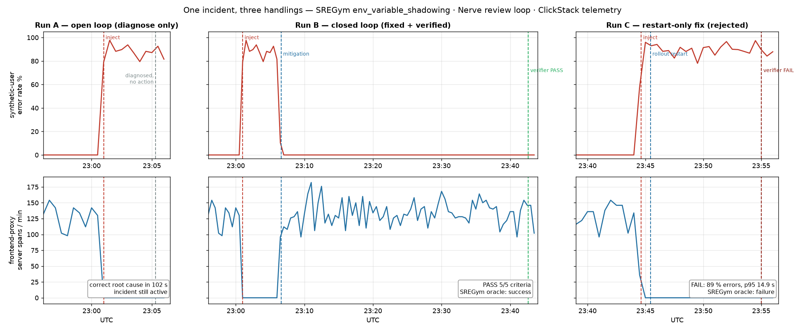
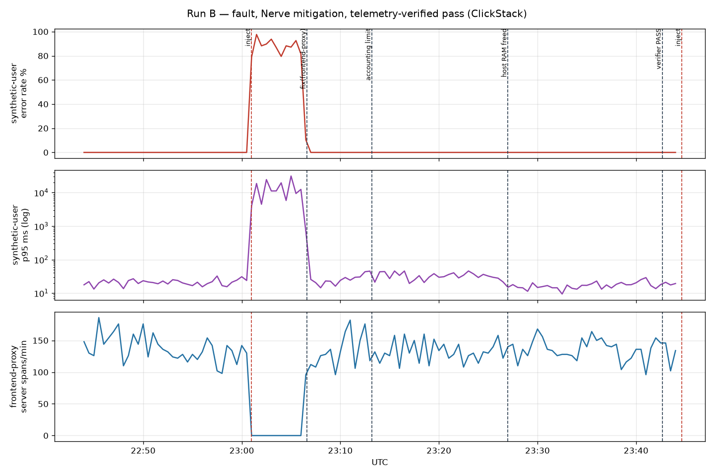
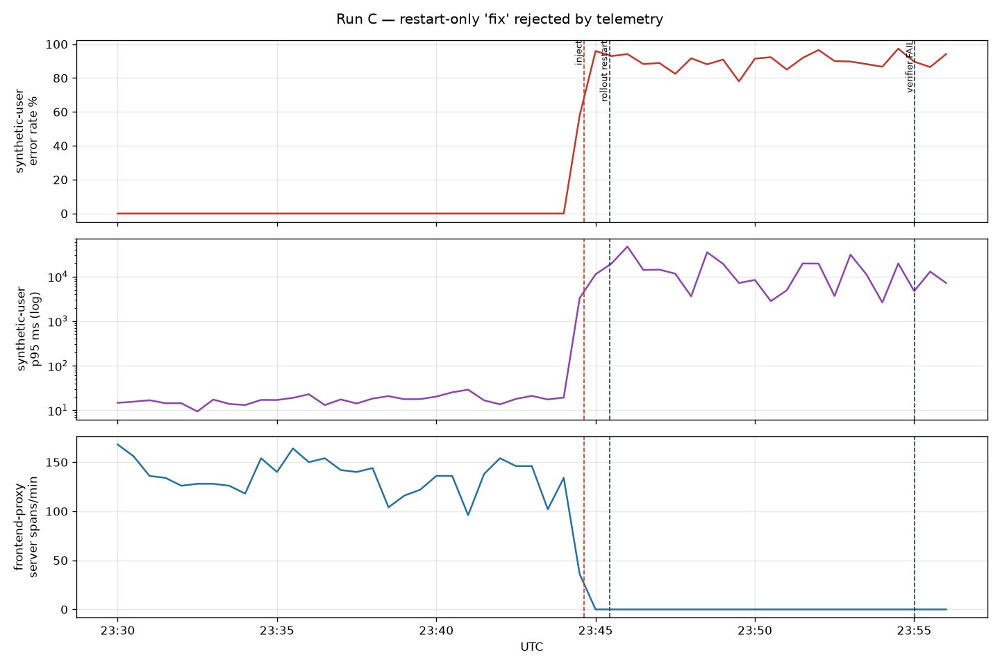

# FINDINGS — closed-loop verification on SREGym × Nerve × ClickStack

**TL;DR.** The closed loop worked, and it earned its keep. It caught two problems that an
open-loop run would have reported as "fixed". Getting there took six pieces of
workspace/config scaffolding:

1. explicit SLIs instead of "the affected service";
2. a baseline/window definition anchored on timeline events;
3. a schema skill;
4. a Codex sandbox network override;
5. an explicit Codex approval override for the local MCP server;
6. a wait rule.

Zero changes to `nerve/` or `sregym/`.

**Timing in one line:** Run B took 37 min from loop start to verified pass: ≈ 13 min of loop work
(mitigate, wait 300 s, verify) and ≈ 24 min lost to two environment issues (host memory pressure
from another app; the Codex MCP approval gap that cost one verifier iteration).



| | Run A (open loop) | Run B (closed loop) | Run C (restart-only) |
|---|---|---|---|
| Outcome | correct root cause, no action | fixed + **verified by telemetry** (`passed`, 5/5 criteria met with SQL evidence), SREGym oracle `success: true` | **rejected** (`fail`, C1/C2/C3 unmet), SREGym oracle `success: false` |
| Time | 102 s agent time (4 min from injection, incl. a deliberate 150 s telemetry wait) | mitigation 57 s after loop start; **verified pass 37 min after loop start** (≈ 13 min without the two infra issues below) | 10 min from loop start to verdict |
| Cost (API-equivalent; ran on subscription) | n/a (single chat turn) | ~$4 | ~$1.4 |
| Telemetry queries | 6 × `run_query` | implementer 14 × `run_query`, verifier #2 its own query covering C1/C2 | verifier: its own MCP queries over W = 300 s |



HyperDX views of the same windows (UTC): `evidence/hyperdx/run-b-before-after.png`, `evidence/hyperdx/run-c-timeline.png`.

**Run 2 and repeats** (2026-11-10):
- Run 2: the criteria and skills transferred to a second fault type (traffic policy) with **0 edits**. B2 passed in 11 min / ~$1.9;
  C2 was rejected (`evidence/run2/FINDINGS-run2.md`).
- 3× repeats of B and C on the original fault: B median 18 min (10–24), ~$2.4 (~$1.6–5.3); C median 9 min (9–11),
  ~$1.3 (~$1.2–1.4) (`evidence/repeats/summary.md`).

## Second signal class: Langfuse

**The agent-quality case** ([`../agent-quality-langfuse/FINDINGS.md`](../agent-quality-langfuse/FINDINGS.md)) runs the same loop on agent quality instead of infra telemetry.

**Setup.**
- System under test: a text-to-SQL agent (Haiku 5.5, BIRD `superhero`), traced and scored in self-hosted Langfuse v4.
- Fault: a schema change (4 column renames). It drops `exec_match` from 84 % to 40 % on the visible `replay` set and on the hidden `oracle` set.
- The implementer may edit only the agent's workspace (`prompt.md`, `schema_notes.md`, `skills/`).
- The verifier must replay the dataset itself (`run_experiment`) and read the scores back from Langfuse.

**Results.**
- **Run B passed** on iteration 3: its own replay scored 93 % with control 20/20; the oracle scored 90 %.
- **Run C** (prompt-only general instructions) **was rejected**: replay 38 %, oracle 38 %.

**What transferred.** The loop shape, the evidence rule (run id + scores, read back by the verifier), the anti-gaming
criterion and the scope check. Only the adapter changed: a 6-tool MCP over the Langfuse experiments API in place of ClickHouse SQL.

**New lessons.**
1. The control-set gate caught a real side effect of the implementer's extra prompt tuning (q837, two rejected
   iterations). That was not model noise. The minimal schema-notes fix alone would have passed.
2. The thresholds for an LLM metric have to come from measured run-to-run noise. Three identical baselines differed
   by 3.3 pp on 60 items. So C1 = mean − max(1 pp, spread), not a fixed −1 pp.
3. Control items must be clean in their question and evidence text, not only in gold SQL.
4. The C4 wording ("`git status` only under `workspace/`") tripped on Nerve's own `.nerve-review/` directory.

## Setup and timings

| Milestone (UTC, 2026-11-09) | t from start |
|---|---|
| start (T0) | 21:59 |
| Docker Desktop raised 7.7 → 16 GB (needed a forced restart: VM network wedged on first relaunch) | +10 min |
| kind cluster ready (4 nodes, Calico) | +14 min |
| ClickStack up, astronomy-shop deployed (svelte profile), traces in ClickHouse — **checkpoint B passed** | +21 min |
| Nerve worker running, smoke test answered with SQL + numbers | +25 min |
| Run A done | +66 min (includes a 17-min operator stall, see Operator log) |
| Run B passed | +104 min |
| Run C rejected (verifier `fail`, oracle `false`) | +116 min |
| Total, with docs and evidence | ≈ 2 h of the 4 h box |

Plan B was **not** needed. SREGym-Lite on kind worked first time once Docker had 16 GB.

## Was the verifier real? Yes. The verdict (iteration 2)

Pinned criteria C1–C5 (`prompts/run-b-verifier.md`). Verifier = Codex (single agent),
cross-vendor vs the Claude implementer.
Full JSON: `evidence/run-b/verdict-iter2.json`.

- **C1 met.** Codex ran the C1 SQL itself via `mcp__clickhouse__run_query`. B = [22:46:00, 23:01:00), 900 s:
  2148 synthetic-user requests, 0 errors, frontend-proxy 135.9 spans/min. W = 300 s ending ~23:42:
  0 errors, volume ≈ 135/min (99 % of baseline).
- **C2 met.** `lg_p95_ns = 22 873 178` (B) vs `19 120 396` (W). The limit is 27 447 813.6.
- **C3 met.** All pods 1/1 Running, RESTARTS=0. A JSON query for not-Ready / restart / CrashLoop / OOMKilled
  after 23:13:12 returned no rows.
- **C4 met.** `rollout history` shows frontend-proxy rev 4→5 with a single `FRONTEND_HOST=frontend`, and accounting
  rev 1→2 with `limits.memory=256Mi`. Image diff of Helm manifest vs live Deployments: 23 = 23, `DIFF_RC=0`.
- **C5 met.** No implementer numbers were used.

## What the closed loop caught that the open loop would not

1. **A pre-existing, unrelated fault.** `accounting` was OOMKilled every ~16 min at the chart's 120 Mi limit,
   during the baseline too. C3 ("no restarts after T_mit") forced the implementer to notice. It raised the limit to 256 Mi
   and moved `MITIGATION_TS_UTC` so the window covered the final state. This is a scope expansion; it was justified by the
   criteria and documented in STATE.md. In a production setup this change should have stopped at a plan-approval
   gate (a human approves edits to resources outside the incident's blast radius); the demo had no such gate.
2. **A latency regression the agent could not fix.** After the fix, errors were 0 % but synthetic-user p95 sat at
   33–45 ms against a 27 ms limit. The implementer showed the slowdown was uniform across *every* service, started
   before its own second change, and traced it to **host memory pressure**: LM Studio held ~12 GB beside Docker's 16 GB on
   a 24 GB Mac. It refused to declare success, did not restart pods "to see", and did not touch processes outside its
   authority. After the operator quit LM Studio (23:27), p95 dropped to 14–17 ms within a minute. An open-loop run would
   have said "fixed" at 23:07.
3. **A plausible-but-wrong fix, rejected with real numbers (Run C).** Same fault and criteria, but the Goal
   allowed only `rollout restart` / pod deletes (a "change freeze"). The implementer restarted `frontend-proxy` at
   23:45:26, waited 300 s, and wrote "⚠️ RESTARTS DID NOT FIX IT" in STATE.md. The verifier returned **`fail`**
   (`gamed: false`) with its own MCP queries over W = 300 s:

   | | baseline [23:29:38, 23:44:38) | W after restart |
   |---|---|---|
   | synthetic-user error rate | ~0 % | **89 %** |
   | frontend-proxy server spans | ~135/min | **0** |
   | synthetic-user p95 | ~20 ms | **14.9 s** |
   | pod | Running | `CrashLoopBackOff`, `OOMKilled @ 23:51:15` (after T_mit) |

   Result: C1/C2/C3 unmet, C4/C5 met. The loop parked in `awaiting_user` (max_iterations=1) and was abandoned via
   `POST /api/review-loops/{id}/decision`. **The SREGym oracle agrees independently:** `success: false`,
   `duplicate_env_definitions`.
   

## What had to live outside the core

Nerve core ran unchanged. Everything below was done in workspace config, criteria text and skills; a product built on the loop would want it in the core.

**For a product version:** criteria as SLO queries with a noise tolerance; a verification window with a validity check (baseline, minimum duration, the system actually served traffic); ClickStack and Langfuse as first-class sources instead of a separate MCP server per signal; a verify-after delay.

| Gap | What happened | Workaround used |
|---|---|---|
| **"Affected service" is undefined when the faulty service goes dark** | The initially planned C1 ("error rate of the affected service") is unmeasurable here. frontend-proxy emits **no** spans while crash-looping, so its error rate is 0/0. | Criteria rewritten as explicit SLIs: `load-generator` Client error rate and p95, plus frontend-proxy server-span volume. A product should let a loop pin **named SLO queries** (SQL + threshold + window) instead of prose. |
| **Host noise vs. criteria** | Host memory pressure (another app holding ~12 GB) raised p95 for every service, so C2 failed for reasons unrelated to the fault. The implementer diagnosed this correctly but could not act on it. It recurred in repeat rep2-B: SREGym's in-memory Jaeger filled its 1 GiB limit and thrashed at ~9.5 cores. Three verifier legs held C2 unmet on a correct fix (oracle success), at a cost of ~$5. | Operator freed RAM; C2 then passed with no criteria change. A product would want a noise guard on latency criteria, e.g. compare the affected path against an unaffected control service, so cluster-wide slowdowns are flagged as environment rather than fix failure. |
| **Baseline / window semantics** | Every leg re-derived the windows from prose. Span `Timestamp` is span *start*, so long requests started before the injection show up as early errors. | Windows anchored on `evidence/timeline.log` (`inject_done`) and `MITIGATION_TS_UTC` in STATE.md; `≥300 s` stated explicitly. A first-class "verification window" (start event, min duration, baseline offset) would remove a whole class of ambiguity. |
| **No check that the observed system was live during W** (Run 2) | During Run C2 the Mac went into idle sleep for ~80 min; kind and the load generator froze. Nothing in the loop noticed; the implementer happened to read `pmset`. Separately, in B2 a TCP-probe oracle would have accepted a half-fix (stale gRPC channel) that the telemetry window caught. | `caffeinate` for unattended runs. A product should treat "W contains ≥ X % of baseline request volume" as a first-class validity check on every verification window, separate from the pass criteria. |
| **Schema knowledge** | ClickStack stores `SpanKind` as `Server/Client/Internal` and `StatusCode` as `Error/Unset/Ok`, not `SPAN_KIND_SERVER` / `STATUS_CODE_ERROR` as the initial plan assumed. `Duration` is in ns. Envoy reasons live in `response_flags`. | `clickstack-schema` skill + saved queries. |
| **Wait between mitigation and verification** | Nothing in the loop knows that telemetry needs time. | Option (a): the Goal tells the implementer not to end its leg until 300 s after `MITIGATION_TS_UTC`. A probe confirmed `sleep` works inside Nerve's Claude sessions. The criterion also told the verifier to sleep if W < 300 s; it wasn't needed. The implementer leg grew to 28 min because it restarted the window after its second change and waited out the host-pressure spell. A "verify-after" delay on the loop would be cleaner than burning an implementer leg on `sleep`. |

**Implementation notes:** explicit approval for local MCP servers, network in the Codex sandbox, `.nerve-review/` in `git status`.

| Gap | What happened | Workaround used |
|---|---|---|
| **Local MCP tools need explicit approval in unattended verifier legs** | Verifier #1: "runtime blocked the only available ClickHouse MCP query tool because interactive approval is disabled". Nerve sets `default_tools_approval_mode="approve"` only for managed-gateway MCP servers (`codex/backend.py`). A local stdio server under `approval_policy=never` is refused. The verifier then queried ClickHouse directly, got passing numbers, and **correctly** marked C1/C2 `unverifiable` and C5 `unmet` because C5 required MCP. That cost one iteration (~$1.2, ~6 min). | `codex.extra_config: mcp_servers.clickhouse.default_tools_approval_mode: approve` (hot-reloaded mid-loop). The refusal is a security boundary: a locally added server is not trusted without an explicit operator decision. The only cost was that it surfaced as an unmet criterion; a pre-flight check that reports it as a configuration error would avoid the lost iteration. |
| **Codex verifier sandbox has no network** | `workspace-write` blocks kubectl → kind API on 127.0.0.1. | `codex.extra_config: sandbox_workspace_write.network_access: true` |
| **`.nerve-review/` in `git status`** (agent-quality case) | Nerve's own untracked `.nerve-review/` directory tripped the scope criterion C4 ("`git status` lists only `workspace/`") in Run B iteration 1 and in Run C ([../agent-quality-langfuse/FINDINGS.md](../agent-quality-langfuse/FINDINGS.md), finding 5). | The implementer added it to `.git/info/exclude`. Fix: exclude `.nerve-review/` in the criterion or in the loop repo setup. |

## Other notes

- **SREGym's fault description vs reality.** `env_variable_shadowing` says the proxy "remains Running and Ready". On this
  setup Envoy's listener is also `:8080`, so `FRONTEND_HOST=localhost` makes it proxy to itself → OOMKilled →
  CrashLoopBackOff. Both runs diagnosed the self-loop correctly.
- **Traces don't go through the observe collector by default for astronomy-shop.** They go through the chart's own
  collector to a `jaeger` Service that SREGym replaces with an ExternalName → `observe/otel-collector`. So teeing in
  `observe` (as initially planned) works, but only because of that ExternalName.
- **ClickStack AIO**: the `default` ClickHouse user is localhost-only inside the container, and OTLP needs an ingestion
  key once a UI team exists. Solved with a mounted read-only user `nerve_ro` and the image's `INGESTION_API_KEY` bootstrap.
- **Nerve on a Claude subscription** (Keychain OAuth token, ~8 h lifetime): chat and workflow legs work, but **memory writes fail
  (401)**, as the docs warn. Use `claude setup-token` or an API key for anything longer than a day.
- **Gaming check.** Verifier #1's refusal to accept its own direct-SQL numbers because C5 said MCP is exactly the
  anti-gaming posture we wanted. It was just aimed at a configuration step (the missing approval override) rather than an implementer.
- **Nothing required touching `nerve/` or `sregym/`.**

## What this does not show

- **Generality.** One app and 2 fault types: env shadowing, plus traffic policy in Run 2 (`evidence/run2/`). Runs of B: 1 + 3
  repeats on fault 1, plus 1 on fault 2. Runs of C: the same, 1 + 3 + 1 (`evidence/repeats/`). That is enough to show variance, not
  to give statistics. The C runs were designed to fail, not sampled.
  - Verdict vs oracle agreed in 9 of 10 runs: B 4/5, C 5/5.
  - The one disagreement (rep2-B) was a correct fix held back by cluster noise on the latency criterion.
- **Production conditions.** A single-tenant kind cluster on a laptop, synthetic load only, no concurrent changes,
  no RBAC limits on the implementer beyond what the Goal text said.
- **Blind root-cause discovery.** The `incident-triage` skill, loaded in Run A, Run B and the repeats, says "Watch for
  duplicated env var names — Kubernetes keeps the **last** definition". That is the mechanism of fault 1
  (`env_variable_shadowing`), so the fault-1 diagnoses (including Run A's 102 s) were not blind. The case tests verification
  of a fix, not root-cause discovery. Fault 2 (traffic policy) reused the skill unchanged; it has no line specific to that fault.
- **Verifier robustness against a motivated implementer.** No implementer tampered with the evaluation itself (criteria,
  saved queries, telemetry). The anti-gaming posture (C5, own queries) met a configuration gap, but was not
  stress-tested against a deliberately adversarial implementer.

## Operator log

Operator errors (not agent errors): local time misread as UTC early on, and a bash-only `[ \> ]` test in a zsh wait loop
stalled ~17 min; C5 also named the MCP tool `run_select_query` instead of `run_query` (Codex handled it). Event times
are in `evidence/timeline.log`.

## Reproduce in < 30 min (warm machine: images cached, Docker at 16 GB)

```bash
bash sre-clickstack/scripts/up.sh                                     # ~8 min warm, ~20 min cold
# wait ≥15 min of clean traffic, then:
cd vendor/SREGym && uv run python ../../sre-clickstack/scripts/sregym_ctl.py inject && cd ../..
python3 sre-clickstack/scripts/nerve_api.py chat --title "Run A" --message-file sre-clickstack/prompts/local/run-a-open-loop.md --out sre-clickstack/runs/run-a/run-a-open-loop.md
python3 sre-clickstack/scripts/nerve_api.py loop --title "Run B" --goal-file sre-clickstack/prompts/local/run-b-goal.md \
  --verifier-file sre-clickstack/prompts/local/run-b-verifier.md --budget 8 --cwd "$PWD/sre-clickstack/loop-workspace/run-b" --out sre-clickstack/runs/run-b
```
See README.md for details.

**Tooling.** Nerve review-loop engines: implementer `claude-workflow`, verifier `codex-ultracode` (Codex CLI 0.164; Ultracode plugin not installed, so single-agent). Versions of everything else are in [../PINS.md](../PINS.md).
