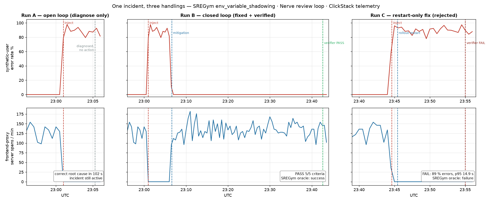

# sre-clickstack: SREGym fault → Nerve review loop → verified via ClickStack

- **Run A (open loop):** Nerve + ClickHouse MCP found the root cause in 102 s and took no action. The incident stayed live.
- **Run B (closed loop):** Claude fixed it. A Codex verifier passed it only on its own SQL: 5/5 criteria met, SREGym oracle ✅.
- **Run C (wrong fix):** A restart-only "fix" was rejected with real numbers (89 % errors, p95 14.9 s). SREGym oracle ❌.

Transfer test to a second fault and 3× repeats: see [evidence/run2](evidence/run2/FINDINGS-run2.md) and [evidence/repeats](evidence/repeats/summary.md).



| Read | What |
|---|---|
| [FINDINGS.md](FINDINGS.md) | results, timings, verdicts, what had to live outside the core; Run 2 and repeats |
| [evidence/verdicts.md](evidence/verdicts.md), `evidence/hyperdx/` | verdict JSON with the SQL and numbers behind C1/C2; HyperDX screenshots of the Run B/C windows (UTC) |
| `evidence/run-a/` | Run A transcript (diagnosis only, with every tool call) |
| `evidence/run-b/` | Run B: `verdict-iter{1,2}.json`, `STATE.final.md`, per-leg transcripts, `sregym-oracle.txt`, `timeline.png`, `times.txt` |
| `evidence/run-c/` | Run C (restart-only fix rejected): `verdict.json`, `STATE.md`, transcripts, oracle, `timeline.png`, `times.txt` |
| `evidence/run2/`, `evidence/repeats/` | second fault type (B2/C2); 3× repeats of B and C |
| `evidence/timeline.log` | inject / recover / oracle events (UTC) |
| `prompts/` | Run A prompt, Run B/C goals, pinned verifier criteria C1–C5, Nerve `TASK.md` |
| `skills/`, `nerve-config.yaml` | Nerve skills and config additions (no secrets) |
| `queries/` | saved ClickHouse verification queries |
| `scripts/` | `up.sh` (one-command setup), `sregym_ctl.py`, `tee-collector.py`, `clickstack-up.sh`, `nerve_api.py`, `chq.sh`, plots, `repeat.sh` |

Upstream sources (Nerve, SREGym, mcp-clickhouse) are cloned into `vendor/` at the commits in [../PINS.md](../PINS.md).
**Historical artifacts vs. reproduction.** `evidence/` and `prompts/` are the record of the runs and are kept as they were.
The prompts hard-code the timeline path of the original checkout (`$HOME/Research/nerve-experiments/demo/evidence/timeline.log`),
which does not exist in a fresh clone. To reproduce:
- run `bash sre-clickstack/scripts/render-prompts.sh` (`up.sh` and `repeat.sh` call it). It writes copies to `prompts/local/`
  (gitignored) that point at `sre-clickstack/runs/timeline.log`, the file `sregym_ctl.py` appends to. Only that path differs;
- pass `prompts/local/*.md` to `nerve_api.py`, and write new output to `sre-clickstack/runs/<run>` (gitignored), as the runbook
  below does, so the recorded evidence is not overwritten;
- `sregym_ctl.py` appends new events to `runs/timeline.log` and `repeat.sh` writes to `runs/repeats/`; nothing writes to `evidence/`.

## Runbook


One incident, handled two ways on the same telemetry:

- **Run A (open loop):** a Nerve session with the ClickHouse MCP diagnoses the fault and stops.
- **Run B (closed loop):** a Nerve review loop (Claude implementer → Codex verifier) mitigates
  it, and the verifier passes the loop only after re-running SQL against ClickStack and
  seeing the user-facing SLIs back at baseline.

```
kind cluster (SREGym)                               host (macOS, Docker Desktop 16 GB)
┌───────────────────────────────────┐   OTLP/HTTP  ┌──────────────────────────────┐
│ astronomy-shop (OTel instrumented)│   + ingest   │ ClickStack all-in-one        │
│  └─ in-ns collector → svc "jaeger"│     key      │  :4318 OTLP → ClickHouse     │
│     (ExternalName) → observe/     │─────────────>│  :8123 SQL (user nerve_ro)   │
│     otel-collector  + exporter    │ host.docker. │  :8080 HyperDX UI            │
│     otlphttp/clickstack           │   internal   └──────────────┬───────────────┘
│ Jaeger / Prometheus untouched     │                             │ mcp-clickhouse (stdio)
└───────────────▲───────────────────┘              ┌──────────────┴───────────────┐
                │ kubectl (kind-kind)              │ Nerve (worker, 127.0.0.1:8900)│
                └──────────────────────────────────│  skills: clickstack-schema,   │
                                                   │          incident-triage      │
                                                   │  review loop: claude-workflow │
                                                   │   → codex verifier (sandbox   │
                                                   │     workspace-write + net)    │
                                                   └───────────────────────────────┘
```

## Problem choice (Step 0)

| Candidate | Telemetry signature | Mitigation | Verdict |
|---|---|---|---|
| `env_variable_shadowing_astronomy_shop` | edge (frontend-proxy) breaks → every synthetic-user request fails | `kubectl` env fix on `deploy/frontend-proxy` | **chosen** |
| `internal_traffic_policy_local_astronomy_shop` | frontend→recommendation connections silently dropped (no RST); spans may hang until app timeout, partial signal | `kubectl patch svc` | weaker signal |
| `secret_rotation_stale_env_credentials_astronomy_shop` | product-catalog DB auth errors | `kubectl rollout restart` *is* the fix | no plausible-but-wrong fix for the negative case |

**Fault:** SREGym appends a second `FRONTEND_HOST=localhost` to the `frontend-proxy`
container env; Kubernetes keeps the last definition, so Envoy's `frontend` upstream
becomes `localhost:8080`.

**Observed telemetry signature (measured, not what SREGym's description predicts):**
SREGym's text says the pod "remains Running and Ready". On this setup Envoy's own
listener is also `:8080`, so the upstream points at itself → request loop →
`frontend-proxy` is **OOMKilled and crash-loops**, and its spans *disappear* rather than
turning into errors. The failure is visible on the synthetic user:

| SLI (`otel_traces`) | baseline | during fault |
|---|---|---|
| `load-generator` `Client` span error rate | ~0 % | ~85–95 % (`ConnectionError … frontend-proxy:8080 … Connection refused`) |
| `load-generator` `Client` p95 latency | ~20 ms | ~6–19 s |
| `frontend-proxy` `Server` spans / min | ~150 | 0 |
| `frontend` `Server` spans / min | ~300 | 0 (starved) |

This is why the verifier criteria (prompts/run-b-verifier.md) are written against
explicit SLIs rather than "the affected service's error rate": the root-cause service
emits no error spans at all.

## Reproduce

### 0. Prerequisites (macOS)
- Docker Desktop with **≥16 GB memory / ≥8 CPUs** (Settings → Resources).
- `brew install kind helm node@22 uv`; `kubectl` (Docker Desktop ships one).
- A Claude Code login on this Mac (Nerve reuses it) and a Codex/ChatGPT login in `~/.codex`.

### 1. Bring everything up (~20 min cold, mostly image pulls)
```bash
bash sre-clickstack/scripts/up.sh --dry-run   # prerequisites + current state, changes nothing
bash sre-clickstack/scripts/up.sh
```
Secrets go to `sre-clickstack/.env` (gitignored; template in `sre-clickstack/.env.example`).
Steps (each also runnable on its own):
| Step | Command |
|---|---|
| kind cluster | `cd vendor/SREGym && bash kind/setup_kind_cluster.sh` |
| ClickStack | `bash sre-clickstack/scripts/clickstack-up.sh` (writes `sre-clickstack/.env`; ports on 127.0.0.1 only, Linux note in the script header) |
| SREGym infra + app | `cd vendor/SREGym && SREGYM_PROFILE=svelte uv run python ../../sre-clickstack/scripts/sregym_ctl.py deploy` |
| tee collector | `cd vendor/SREGym && uv run python ../../sre-clickstack/scripts/tee-collector.py` |
| Nerve | see `up.sh` step 6 |

Check: `sre-clickstack/scripts/chq.sh -f sre-clickstack/queries/error_rate.sql` lists ~15 services.

### 2. Let ≥15 min of clean traffic accumulate (baseline window), then inject
```bash
cd vendor/SREGym && uv run python ../../sre-clickstack/scripts/sregym_ctl.py inject
```
(`sre-clickstack/runs/timeline.log` gets `inject_done` — the baseline boundary.)

### 3. Run A — open loop (diagnosis only)
```bash
python3 sre-clickstack/scripts/nerve_api.py chat --title "Run A: open-loop diagnosis" \
  --message-file sre-clickstack/prompts/local/run-a-open-loop.md --out sre-clickstack/runs/run-a/run-a-open-loop.md
```

### 4. Run B — closed loop
```bash
mkdir -p sre-clickstack/loop-workspace
python3 sre-clickstack/scripts/nerve_api.py loop --title "Run B: closed loop" \
  --goal-file sre-clickstack/prompts/local/run-b-goal.md --verifier-file sre-clickstack/prompts/local/run-b-verifier.md \
  --budget 8 --cwd "$PWD/sre-clickstack/loop-workspace" --out sre-clickstack/runs/run-b
python3 sre-clickstack/scripts/nerve_api.py loop-status --loop-id <id>     # or watch the Nerve UI
cd vendor/SREGym && uv run python ../../sre-clickstack/scripts/sregym_ctl.py oracle   # SREGym ground truth
```

### 4b. Run C — negative case (plausible-but-wrong fix)
Re-inject (step 2) after resetting, then start a loop whose Goal only allows restarts:
```bash
python3 sre-clickstack/scripts/nerve_api.py loop --title "Run C: restart-only" \
  --goal-file sre-clickstack/prompts/local/run-c-goal.md --verifier-file sre-clickstack/prompts/local/run-b-verifier.md \
  --budget 4 --max-iterations 1 --cwd "$PWD/sre-clickstack/loop-workspace/run-c" --out sre-clickstack/runs/run-c
```
Expected: verifier returns `needs_improvement` with C1/C2/C3 unmet and real numbers; loop parks in `awaiting_user`.

### Required Nerve config bits (already in `nerve-config.yaml`)
- `codex.extra_config.sandbox_workspace_write.network_access: true` (verifier needs kubectl → kind API)
- `codex.extra_config.mcp_servers.clickhouse.default_tools_approval_mode: approve` — Codex does not auto-approve
  operator-added local MCP servers, so without it the verifier legs (`approval_policy=never`) cannot use the ClickHouse tool, and C5 fails.

### 4c. Second fault and unattended repeats
- Other SREGym problem: prefix `sregym_ctl.py` calls with `DEMO_PROBLEM=internal_traffic_policy_local_astronomy_shop`
  (`recover` then calls the problem's own stateless `recover_fault`). Choice and prediction: `evidence/run2/CHOICE.md`.
- `nerve_api.py loop ... --wait [--abandon-on-park]` blocks until the loop settles and collects verdicts, STATE.md and transcripts.
- `bash sre-clickstack/scripts/repeat.sh 3` runs N × (16-min baseline → inject → B → oracle → reset → … → C → …) under
  `caffeinate -is`, refreshing Nerve's Claude token before each loop. Output: `runs/repeats/results.csv`, `runs/repeats/summary.md` (`scripts/summarize_repeats.py`) and one folder per run. The recorded
  repeats are in `evidence/repeats/`; `summarize_repeats.py --historical` prints their summary without writing.
  To re-run one run: `RUN_ONLY=rep3-C:C bash sre-clickstack/scripts/repeat.sh`.
- If port 8080 is taken, set `HYPERDX_PORT=8081` in `sre-clickstack/.env` before `up.sh`.

### 5. Reset between runs
```bash
cd vendor/SREGym && uv run python ../../sre-clickstack/scripts/sregym_ctl.py recover
```

## Saved queries
`sre-clickstack/queries/error_rate.sql`, `p95_latency.sql`, `baseline_vs_window.sql` — run with
`sre-clickstack/scripts/chq.sh -f <file>`. ClickStack's schema stores `SpanKind` as
`Server|Client|Internal` and `StatusCode` as `Error|Unset|Ok` (not the OTLP enum names).
